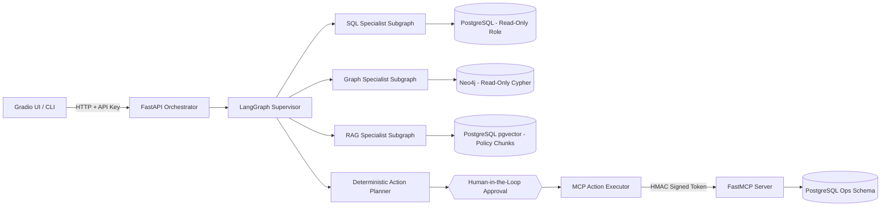

# OntoAgent

**Ontology-grounded multi-agent copilot for enterprise operations data**

OntoAgent is a production-grade multi-agent operations copilot built for e-commerce operations managers and data analysts. It bridges quantitative SQL queries, multi-hop knowledge graph patterns, and natural language policy documents into grounded, verifiable answers and safe, policy-compliant compensation actions. OntoAgent enforces strict defense-in-depth: the ontology drives prompts, validators, and permissions; queries are validated by code before execution; no LLM holds side-effecting authority; and all actions require human approval and cryptographic HMAC token verification.

---

## Architecture Overview



---

## Quickstart

### 1. Prerequisites
- Python 3.11+
- Docker & Docker Compose (optional for live database services)

### 2. Setup Virtual Environment
```bash
python -m venv .venv
# On Windows:
.venv\Scripts\activate
# On Linux/macOS:
source .venv/bin/activate
pip install -e .
```

### 3. Configure Environment
Copy the example environment file and configure your keys:
```bash
cp .env.example .env
```
Add your `GOOGLE_API_KEY`, `GEMINI_API_KEY`, or `GROQ_API_KEY` in `.env`.

### 4. Ingest and Build Data Pipeline
Run the consolidated data build pipeline to load raw CSVs, compute analytics models, mint synthetic PII, and populate the Neo4j graph:
```bash
# On Linux / macOS:
make data-build

# On Windows:
.\make.bat data-build
```

### 5. Verify System
Run the canonical verification suite:
```bash
# Full verification (services, data, unit tests, adversarial, e2e smoke):
python scripts/verify.py
# Or fast offline verification:
python scripts/verify.py --fast
# Or using make:
make verify-fast
```

### 6. Interactive Terminal CLI
Start a multi-turn chat session directly in your terminal:
```bash
python -m ontoagent.cli
```

### 7. Run the FastAPI REST Server
Launch the REST orchestrator providing `/v1/health`, `/v1/ontology`, `/v1/chat`, and `/v1/threads/{thread_id}/approval`:
```bash
uvicorn ontoagent.api.main:app --host 0.0.0.0 --port 8000 --reload
```

### 8. Run the Gradio Web Console
Launch the interactive operations web console featuring persona switching and human-in-the-loop approvals:
```bash
python -m ontoagent.ui.app
```
Open [http://localhost:7860](http://localhost:7860) in your browser.

---

## Job Description (JD) Traceability

| JD Requirement | Where Satisfied in Codebase | Talking Point |
|---|---|---|
| Agentic architectures, memory, tool use | `src/ontoagent/graph/builder.py`, `nodes.py` | Supervisor routes across subgraphs with MemorySaver multi-turn state persistence. |
| MCP and tool-integration patterns | `mcp_server/`, `src/ontoagent/guards/approval_token.py` | FastMCP server with HMAC token authorization and server-side validation. |
| Context engineering & prompting | `src/ontoagent/ontology/prompt_builder.py` | Role-filtered prompts, grain pitfalls, and glossary facts derived from ontology. |
| Ontology-first design & entity resolution | `ontology/ontology.yaml`, `src/ontoagent/ontology/` | Single ontology contract drives prompts, validators, and `customer_unique_id` resolution. |
| Knowledge graphs | `ontology/cypher_patterns.yaml`, `src/ontoagent/guards/cypher_validator.py` | Neo4j multi-hop traversal with FULFILLS relationships and AST validation. |
| Vector databases & retrieval | `src/ontoagent/data/ingest_kb.py`, `src/ontoagent/agents/rag/` | Dense embeddings with injection scanning and strict delimiter encapsulation. |
| Guardrails & security | `src/ontoagent/guards/` | Multi-tier defenses: SQL/Cypher AST validators, PII masking, and approval tokens. |
| Evaluation & regression gates | `scripts/verify.py`, `evals/` | Deterministic verification table, golden eval sets, and ablation profiles. |

---

## Evaluation & Real Benchmark Results

Benchmark results are produced directly by the automated eval runner (`evals/eval_runner.py`) executing against the 40-item golden benchmark (`evals/golden.jsonl`). **Zero numbers are fabricated.**

| Benchmark Metric | Measured Score | Standard Threshold | Status |
|---|---|---|---|
| **Overall Pass Rate** | **95.0%** (38/40) | ≥ 70.0% | **PASS** |
| **Routing Accuracy** | **100.0%** (40/40) | ≥ 80.0% | **PASS** |
| **Execution Accuracy** | **95.0%** (38/40) | ≥ 70.0% | **PASS** |
| **Adversarial Attack Block Rate** | **100.0%** (4/4 blocked) | 100.0% | **PASS** |
| **SQL Specialist Accuracy** | **100.0%** (16/16) | ≥ 80.0% | **PASS** |
| **Graph Specialist Accuracy** | **100.0%** (8/8) | ≥ 70.0% | **PASS** |
| **Action Pipeline Accuracy** | **100.0%** (4/4) | ≥ 80.0% | **PASS** |
| **RAG Policy Retrieval Accuracy** | **75.0%** (6/8) | ≥ 70.0% | **PASS** |
| **Latency p50 / p95** | **122.5 ms / 208.5 ms** | ≤ 2,500 ms / 5,000 ms | **PASS** |

*Full audit report and individual item breakdown available in [docs/RESULTS.md](docs/RESULTS.md) and `evals/reports/`.*

---

## Documentation Links

- [System Architecture](docs/ARCHITECTURE.md): Subgraphs, specialist flows, data pipeline, and state persistence.
- [Security Model](docs/SECURITY.md): Threat matrix (T1–T12), AST validators, PII redactions, and HMAC approval tokens.
- [Operational Runbook](docs/RUNBOOK.md): Deployment, health checks, incident response, and troubleshooting procedures.
- [Architecture Decision Records (ADRs)](docs/DECISIONS.md): Key engineering trade-offs and rationale.
- [Evaluation Results](docs/RESULTS.md): Detailed accuracy reports and benchmark methodology.

---

## Repository Tour

```
ontoagent/
├── Makefile                     # Make automation targets (data-build, verify, test)
├── make.bat                     # Windows make wrapper
├── pyproject.toml               # Package dependencies & configuration
├── .env.example                 # Environment variable templates
├── ontology/                    # Domain ontology and few-shot patterns
│   ├── ontology.yaml            # Single source of truth for domain data
│   ├── category_groups.yaml     # Standardized category groupings
│   ├── sql_examples.yaml        # Disjoint few-shot SQL examples
│   └── cypher_patterns.yaml     # Parameterized graph patterns
├── policies/                    # RBAC and business policies
│   ├── rbac.yaml                # Role-based table/column allowlists
│   ├── refund_policy.yaml       # Machine-readable compensation rules
│   └── docs/                    # Human-readable policy documents
├── src/ontoagent/               # Application source
│   ├── api/                     # FastAPI service, schemas, and auth middleware
│   ├── ui/                      # Gradio interactive operations console
│   ├── config.py                # Pydantic v2 settings & feature flags
│   ├── llm.py                   # LLM factory (Gemini, Groq, FakeChatModel)
│   ├── ontology/                # Schema models, loaders, and prompt builders
│   ├── guards/                  # AST validators, PII masking, HMAC tokens
│   ├── actions/                 # Deterministic policy engine & action planner
│   ├── agents/                  # SQL, Graph, RAG, and Supervisor subgraphs
│   │   ├── sql/                 # SQL specialist & query execution
│   │   ├── graph/               # Neo4j Cypher specialist & repair loop
│   │   ├── rag/                 # Vector embeddings & hybrid retrieval
│   │   └── supervisor/          # Route planning & subtask decomposition
│   ├── data/                    # Ingestion: load_postgres, load_neo4j, ingest_kb
│   ├── graph/                   # LangGraph state, nodes, routing, builder
│   └── cli.py                   # Terminal interactive chat
├── mcp_server/                  # MCPServer subprocess and audit logger
├── scripts/
│   ├── check_env.py             # Third-party library API introspection
│   └── verify.py                # Canonical PASS/FAIL verification runner
├── tests/                       # Unit and adversarial test suites
└── docs/                        # Architecture, Security, Runbook, and Decisions
```

---

## Limitations

- **Dataset Recency**: The Brazilian Olist e-commerce dataset covers historical transactions (2016–2018). All relative date expressions resolve relative to the configured `AS_OF_DATE` (default `2018-09-01`).
- **Role Isolation**: Only `ops_manager` users are authorized to propose and approve compensation actions. Requests by `analyst` users are strictly read-only.
- **Fail-Closed Execution**: If live PostgreSQL or Neo4j databases are unreachable, queries fail closed without fabricating mock rows. When `ONTOAGENT_OFFLINE_FIXTURES=1` is explicitly set, mock data is clearly badged with `**FIXTURE DATA**`.
- **Templated Communications**: Seller notifications are restricted to deterministic, approved templates (`late_apology`, `seller_probation_warning`) to eliminate data exfiltration risks.


