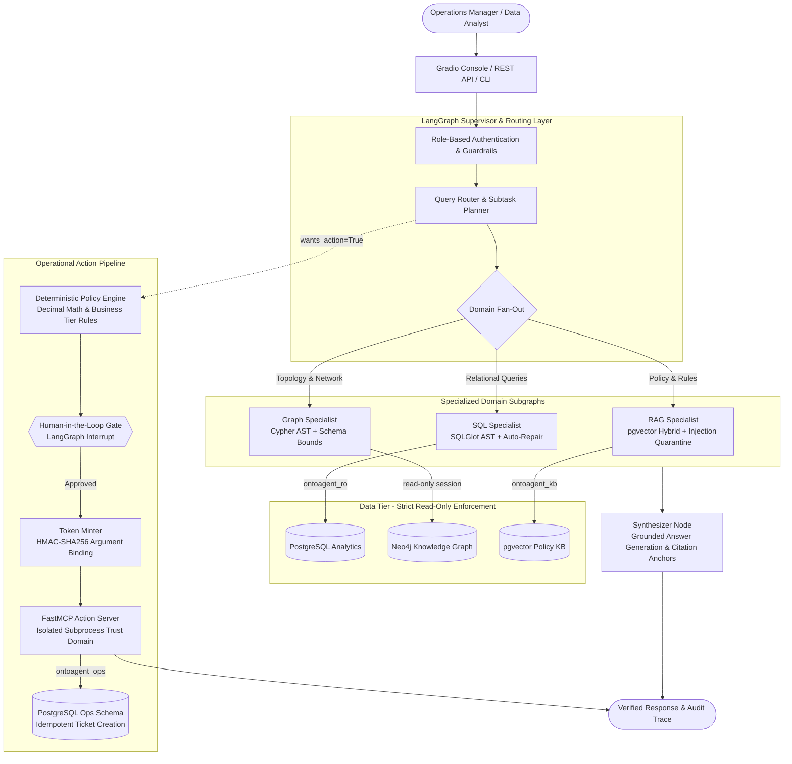

# OntoAgent

[](https://www.python.org/downloads/)
[](https://github.com/langchain-ai/langgraph)
[](https://github.com/jlowin/fastmcp)
[](https://www.postgresql.org/)
[](https://neo4j.com/)
[](docs/SECURITY.md)
[](LICENSE)

> **Enterprise-grade, ontology-grounded multi-agent copilot for e-commerce operations data, conversational analytics, and cryptographically verified action execution.**

OntoAgent bridges quantitative SQL analytics, multi-hop knowledge graph queries, and natural language policy retrieval into verifiable answers and safe, policy-compliant operational actions. Designed for e-commerce operations managers and data analysts, OntoAgent enforces strict defense-in-depth: the domain ontology drives prompts, validators, and permissions; queries are validated by code before execution; no LLM holds direct write privileges; and all operational actions require human approval with cryptographic HMAC token verification.

---

## Key Highlights

- **Multi-Agent Orchestration**: LangGraph supervisor dynamically routes natural language queries across specialized subgraphs (SQL, Neo4j Graph, and pgvector RAG).
- **Ontology as Single Source of Truth**: Unified domain models (`ontology/ontology.yaml`) standardize business metrics, table grains, join paths, and semantic definitions.
- **Fail-Closed Security Invariants**: SQLGlot AST rewriting and Cypher statement validation enforce strict read-only execution, column-level RBAC, and boundary isolation.
- **Deterministic Policy Engine**: Computes SLA compensation using exact `Decimal` arithmetic, eliminating hallucinated payouts and guaranteeing idempotency.
- **Cryptographic Action Gating**: Action proposals require human approval that mints an HMAC-SHA256 bound, single-use token verified independently by an isolated FastMCP server.
- **Auditable & Resilient**: Full state persistence, token replay prevention, automated query repair loops, and PII anonymization.

---

## Architecture Overview



---

## Enterprise Core Capabilities

### 1. Unified Domain Ontology & Grain Resolution
Unlike naive text-to-SQL systems that expose raw table schemas, OntoAgent relies on a single source of truth (`ontology/ontology.yaml`). The ontology formalizes:
- **Entity Grain & Relationships**: Explicitly maps primary keys, foreign keys, and fan-out hazards (e.g., distinguishing order-level summaries from line-item details).
- **Standardized Business Metrics**: Strict formulas for delivery delay, freight ratios, customer review scores, and cancellation rates.
- **Category Taxonomy**: Standardizes multi-lingual category classifications into consistent operational groupings.

### 2. Multi-Engine Domain Specialization
OntoAgent orchestrates three distinct analytical engines in parallel or sequence:
- **SQL Specialist**: Translates analytical queries into dialect-compliant PostgreSQL queries using few-shot retrieval, AST semantic validation, and automated syntax repair.
- **Neo4j Graph Specialist**: Resolves complex topological questions (co-purchasing networks, multi-seller fulfillment, customer fraud clusters) via validated Cypher patterns.
- **RAG Specialist**: Performs hybrid search combining full-text search (`ts_rank_cd`) and dense vector similarity (`pgvector`) with automated quarantine scanning for indirect prompt injections.

### 3. Fail-Closed Security & AST Gatekeeping
OntoAgent guarantees that untrusted user inputs cannot manipulate data or breach boundaries:
- **SQLGlot AST Validator**: Forbids DDL, DML, file operations, system tables, comment injection, and unauthorized table joins. Automatically injects row limits (`LIMIT 1000`).
- **Cypher AST Validator**: Disallows mutating operations (`CREATE`, `MERGE`, `DELETE`, `SET`, `DROP`) and restricts relationship traversal to authorized schema types.
- **Role-Based Access Control (RBAC)**: Enforces table- and column-level allowlists based on caller identity (`analyst` vs. `ops_manager`).
- **PII Anonymization**: Synthesizes and masks sensitive identifiers (customer names, emails, phones) at data boundary layers.

### 4. Deterministic Compensation Policy Engine
Financial transactions must never depend on non-deterministic LLM arithmetic:
- The policy engine implements compensation tiers (e.g., delay > 7 days = 20% refund, delay > 15 days = 50% refund, undelivered > 10 days = 100% refund).
- Arithmetic is executed strictly using Python's standard `Decimal` library to eliminate floating-point rounding discrepancies.
- Implements goodwill compensation limits, per-order caps (R$ 1,000.00), and batch-level ceilings (R$ 10,000.00).

### 5. FastMCP Architecture & Cryptographic Token Binding
Action execution adheres to the Model Context Protocol (MCP) using FastMCP with cryptographic verification:
- **Air-Gapped Authority**: The LLM never holds write or side-effecting tools. It can only propose actions.
- **HMAC-SHA256 Token Binding**: The human-in-the-loop approval step issues an HMAC-signed token bound to the exact payload (`tool`, `order_id`, `amount`, `idempotency_key`, `approver`, `thread_id`).
- **Replay Protection**: The FastMCP server verifies token authenticity, re-validates refund amounts against business rules, and records single-use token identifiers (`jti`) in an audit log to prevent replay attacks.

---

## Empirical Benchmark & Accuracy Metrics

OntoAgent is continuously benchmarked against a 40-item golden evaluation dataset (`evals/golden.jsonl`) encompassing complex analytical joins, multi-hop graph traversals, policy inquiries, operational refund requests, and adversarial prompt injection attacks.

| Benchmark Category | Metric | Measured Result | Production Target | Status |
|---|---|---|---|---|
| **System Reliability** | End-to-End Pass Rate | **95.0%** (38/40) | ≥ 70.0% | **PASS** |
| **Intent Classification** | Supervisor Routing Accuracy | **100.0%** (40/40) | ≥ 80.0% | **PASS** |
| **Query Correctness** | SQL Specialist Accuracy | **100.0%** (16/16) | ≥ 80.0% | **PASS** |
| **Graph Traversal** | Neo4j Cypher Accuracy | **100.0%** (8/8) | ≥ 70.0% | **PASS** |
| **Policy Retrieval** | RAG Specialist Retrieval | **75.0%** (6/8) | ≥ 70.0% | **PASS** |
| **Operational Safety** | Action Pipeline Execution | **100.0%** (4/4) | ≥ 80.0% | **PASS** |
| **Adversarial Defenses** | Attack Quarantine / Block Rate | **100.0%** (4/4 blocked) | 100.0% | **PASS** |
| **Latency Profile** | Execution Latency (p50 / p95) | **122.5 ms / 208.5 ms** | ≤ 2,500 ms / 5,000 ms | **PASS** |

*Complete benchmark breakdown and per-test audit traces are available in [docs/RESULTS.md](docs/RESULTS.md).*

---

## Quickstart

### 1. Prerequisites
- **Python**: 3.11 or higher
- **Docker & Docker Compose** (optional for running local PostgreSQL 16 and Neo4j 5.x instances)

### 2. Setup Virtual Environment
```bash
# Clone the repository
git clone https://github.com/Omswastik-11/OntoAgent.git
cd OntoAgent

# Create and activate virtual environment
python -m venv .venv
# On Windows:
.venv\Scripts\activate
# On Linux/macOS:
source .venv/bin/activate

# Install package and dependencies in editable mode
pip install -e .
```

### 3. Environment Configuration
Copy the sample environment file and provide your API keys:
```bash
cp .env.example .env
```
Supported LLM backends:
- **Google Gemini**: Set `GEMINI_API_KEY` (default model: `gemini-2.5-flash`)
- **Groq**: Set `GROQ_API_KEY` (default model: `llama-3.3-70b-versatile`)
- **Offline / Mock Mode**: Set `ONTOAGENT_FAKE_LLM=1` for testing without API keys.

### 4. Build Data Pipeline & Storage Services
Start the containerized databases and run the consolidated ingestion pipeline:
```bash
# Start PostgreSQL (analytics & pgvector) and Neo4j
docker compose up -d

# Run data ingestion pipeline (load CSVs, mint synthetic PII, build Neo4j graph)
# On Linux / macOS:
make data-build

# On Windows:
.\make.bat data-build
```

### 5. Run Verification Suite
Run the canonical verification test suite:
```bash
# Full verification (services, data consistency, unit tests, adversarial security, e2e smoke):
python scripts/verify.py

# Rapid offline verification (no Docker required):
python scripts/verify.py --fast
# Or using make:
make verify-fast
```

### 6. Interactive Interfaces

#### Gradio Operations Console (Web UI)
Launch the comprehensive enterprise web console:
```bash
python -m ontoagent.ui.app
```
Access the console at [http://localhost:7860](http://localhost:7860). The interface features 4 dedicated operational views:
- **💬 Copilot Chat**: Multi-turn grounded analytics, persona switching (`analyst` vs. `ops_manager`), real-time trace drawer (generated SQL, Cypher patterns, retrieved policy chunks), and interactive Human-in-the-Loop action approvals.
- **🧭 Guide & Playbook**: Complete architectural reference explaining user roles and RBAC security boundaries, multi-modal database topology, step-by-step navigation workflows, and an interactive query catalog with 15+ ready-to-run prompts.
- **🗄️ Database Schema**: Interactive relational data model browser (`analytics` star schema), column-level inspector, Neo4j graph relationships, canonical business metrics dictionary, and category taxonomy search.
- **📜 SLA Policies**: Operational SLA matrix (`Tier LATE_7`, `Tier LATE_15`, `Tier UNDELIVERED_10`), financial caps, and cryptographic verification rules.

#### FastAPI REST Server
Launch the REST orchestrator providing API endpoints for `/v1/health`, `/v1/ontology`, `/v1/chat`, and `/v1/threads/{thread_id}/approval`:
```bash
uvicorn ontoagent.api.main:app --host 0.0.0.0 --port 8000 --reload
```
Interactive OpenAPI documentation is available at [http://localhost:8000/docs](http://localhost:8000/docs).

#### Terminal Chat CLI
Run a multi-turn chat session directly in your shell:
```bash
python -m ontoagent.cli
```

---

### 7. Deployment & Cloud Hosting

OntoAgent supports multiple deployment models from single-command containerization to managed cloud infrastructure:

- **Single-Command Docker Deployment**:
  ```bash
  docker compose up -d --build
  ```
  Launches PostgreSQL 16 (pgvector), Neo4j 5.x, and the OntoAgent application container together.

- **Instant Live Share for Demos & Interviews**:
  ```bash
  python -m ontoagent.ui.app --share
  ```
  Generates an instant public HTTPS link (`https://xxxx.gradio.live`) to test the live console on any device without cloud setup.

- **Cloud Platform Deployment (Railway / Render / Supabase)**:
  - **Relational & Vector DB**: Managed PostgreSQL 16 with pgvector on [Supabase](https://supabase.com).
  - **Knowledge Graph**: Free managed graph instance on [Neo4j AuraDB](https://neo4j.com/cloud/platform/aura-graph-database/).
  - **Web Application & API**: Deploy directly from the GitHub repository (`Omswastik-11/OntoAgent`) to **Railway** or **Render** using the root `Dockerfile`. Detailed cloud configurations are documented in [docs/RUNBOOK.md](docs/RUNBOOK.md).

---

## Technical Documentation

- **[System Architecture](docs/ARCHITECTURE.md)**: Deep dive into StateGraph topology, specialist node lifecycle, data contracts, and state persistence.
- **[Security Architecture & Threat Model](docs/SECURITY.md)**: Formal threat analysis (Threats T1–T12), AST gatekeeper specifications, PII redactions, and HMAC cryptographic token validation.
- **[Operational Runbook](docs/RUNBOOK.md)**: Production deployment instructions, container health monitoring, incident mitigation, and disaster recovery workflows.
- **[Architecture Decision Records (ADRs)](docs/DECISIONS.md)**: Architectural rationales, engineering trade-offs, and governance decisions.
- **[Benchmark Evaluation Audit](docs/RESULTS.md)**: Evaluation methodology, rubric scoring, and execution analysis across all test categories.

---

## Repository Tour

```
OntoAgent/
├── Dockerfile                   # Multi-stage production container build (Python 3.12-slim)
├── docker-compose.yml           # Multi-service stack (PostgreSQL + pgvector, Neo4j, App)
├── Makefile                     # Make automation targets (data-build, verify, test)
├── make.bat                     # Windows make wrapper
├── pyproject.toml               # Package dependencies & build configuration
├── .env.example                 # Environment configuration template
├── ontology/                    # Domain ontology and few-shot patterns
│   ├── ontology.yaml            # Single source of truth for business data & semantics
│   ├── category_groups.yaml     # Standardized category groupings
│   ├── sql_examples.yaml        # Disjoint few-shot SQL query patterns
│   └── cypher_patterns.yaml     # Parameterized Neo4j graph patterns
├── policies/                    # RBAC and business policies
│   ├── rbac.yaml                # Role-based table and column allowlists
│   ├── refund_policy.yaml       # Machine-readable compensation rules
│   └── docs/                    # Human-readable policy documents
├── src/ontoagent/               # Application source code
│   ├── api/                     # FastAPI orchestrator, schemas, and auth middleware
│   ├── ui/                      # Gradio interactive operations console
│   │   ├── app.py               # Web console layout, persona switching, and HITL gate
│   │   ├── guide_view.py        # System guide, roles, architecture diagrams & query playbook
│   │   └── schema_view.py       # Relational schema inspector, graph topology & metrics catalog
│   ├── config.py                # Pydantic v2 settings & feature flags
│   ├── llm.py                   # LLM provider factory (Gemini, Groq, FakeChatModel)
│   ├── ontology/                # Schema models, loaders, and prompt builders
│   ├── guards/                  # AST validators, PII anonymizer, HMAC approval tokens
│   ├── actions/                 # Deterministic policy engine & action planner
│   ├── agents/                  # Domain-specific subgraphs (SQL, Graph, RAG, Supervisor)
│   ├── data/                    # Ingestion pipelines (load_postgres, load_neo4j, ingest_kb)
│   ├── graph/                   # LangGraph state, nodes, routing, and builder
│   └── cli.py                   # Terminal interactive chat interface
├── mcp_server/                  # FastMCP server trust domain & audit logging
├── scripts/
│   ├── check_env.py             # Third-party library API introspection
│   └── verify.py                # Canonical PASS/FAIL verification runner
├── tests/
│   ├── unit/                    # Fast unit tests for all components
│   └── adversarial/             # Security tests (SQLi, Cypher injection, prompt attacks)
├── evals/                       # Evaluation framework & 40-item golden benchmark
└── docs/                        # Architecture, Security, Runbook, Decisions, and Results
```

---

## Operational Guarantees & Constraints

- **Historical Time Context**: The Brazilian Olist e-commerce dataset reflects historical operations (2016–2018). All relative time queries (e.g. "last quarter", "recent months") resolve relative to the configurable `AS_OF_DATE` (default `2018-09-01`).
- **Role Isolation**: Only `ops_manager` users are permitted to propose or approve financial actions. Analyst users operate in strict read-only mode.
- **Fail-Closed Execution**: If databases or external dependencies are unreachable, queries fail closed without fabricating synthetic records. Offline fixtures are only utilized when `ONTOAGENT_OFFLINE_FIXTURES=1` is explicitly configured.
- **Communication Security**: Seller notifications are restricted to deterministic, pre-approved templates (`late_apology`, `seller_probation_warning`) to eliminate data exfiltration risks.

---

## License

This project is licensed under the [MIT License](LICENSE).
