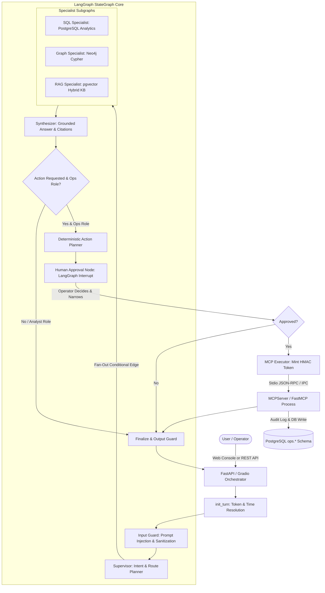

# OntoAgent System Architecture

## 1. Overview & High-Level Design

OntoAgent is an ontology-grounded multi-agent operations copilot designed for enterprise e-commerce platforms. It provides reliable, verifiable answers across multi-modal enterprise data sources (relational SQL, property graphs, and policy documentation) and coordinates safe, bounded operational refund actions with human-in-the-loop (HITL) authorization.

The architecture enforces a strict **separation of concerns**:
- **Ontology as the Single Source of Truth**: All schema semantics, relationships, and business metrics are defined declaratively in `ontology/ontology.yaml`.
- **Specialist Subgraphs**: Isolated agent runnables dedicated to specific query domains (SQL, Cypher Graph, RAG Knowledge Base).
- **Stateless Execution with Checkpointed State**: Multi-turn conversations and interrupted turns persist via LangGraph checkpointer memory.
- **Fail-Closed Security Boundaries**: Defense-in-depth across input sanitization, query AST validators, read-only database roles, cryptographic HMAC approval tokens, and isolated MCP tool execution.

---

## 2. System Architecture Diagram

---

## 3. Core Subgraphs & Specialists

### 3.1 Supervisor (`src/ontoagent/graph/nodes.py`)
- Evaluates incoming questions using the domain ontology summary and few-shot patterns.
- Produces a structured `RoutePlan` with discrete subtasks (`sql`, `graph`, `rag`).
- Determines whether operational side-effects (`wants_action`) are requested, strictly gated by user role (`ops_manager` required).

### 3.2 SQL Specialist Subgraph (`src/ontoagent/agents/sql/`)
- Generates PostgreSQL queries against the denormalized `analytics.*` schema (`fct_orders`, `fct_order_items`, `fct_reviews`, `dim_seller`, `dim_product`, `dim_customer`).
- Validates queries through `sqlglot` AST safety guards:
  - Enforces read-only statements (`SELECT` only; rejects `INSERT`, `UPDATE`, `DELETE`, `DROP`).
  - Restricts schema access strictly to `analytics.*` (denies `raw.*`, `ops.*`, `pg_catalog`).
  - Automatically injects `LIMIT` clauses if missing.
- Implements an automated SQL syntax and validation repair loop (up to 2 iterations).
- Executes queries against PostgreSQL using the unprivileged `ontoagent_ro` user.

### 3.3 Graph Specialist Subgraph (`src/ontoagent/agents/graph/`)
- Translates network and topology questions into Neo4j Cypher queries.
- Grounds generation using canonical parameterized patterns from `ontology/cypher_patterns.yaml`.
- Enforces strict Cypher AST validation (`src/ontoagent/guards/cypher_validator.py`):
  - Read-only queries only (`MATCH`, `WITH`, `RETURN`, `ORDER BY`, `LIMIT`).
  - Forbids mutation keywords (`CREATE`, `MERGE`, `SET`, `DELETE`, `REMOVE`, `DETACH`).
  - Caps traversal depth and limits results to ≤ 100 rows.
- Executes asynchronously via the official `neo4j` Python driver.

### 3.4 RAG Specialist Subgraph (`src/ontoagent/agents/rag/`)
- Retrieves policy context from `kb.policy_chunks` using dense vector embeddings (`sentence-transformers/all-MiniLM-L6-v2`) and BM25 full-text keywords.
- Encapsulates retrieved chunks within strict `<untrusted_data>` delimiters to mitigate indirect prompt injection.
- Extracts explicit citation anchors (e.g. `[refund_policy#Tier LATE_7]`) for downstream grounding.

### 3.5 Synthesizer (`src/ontoagent/graph/nodes.py`)
- Aggregates outputs from parallel specialists.
- Generates answers strictly grounded in retrieved SQL rows, graph nodes, and policy excerpts.
- Fails closed: if specialist execution failed or returned zero records, the synthesizer refuses to hallucinate facts or numbers.

---

## 4. Operational Action Path & HITL Approval

Side-effecting actions (e.g. customer compensation, refund tickets, seller notifications) follow a multi-tier defense:

1. **Role Gating**: Only the `ops_manager` role is authorized to reach `action_planner`. Requests by `analyst` users terminate with a clean role refusal.
2. **Deterministic Arithmetic**: The LLM *never* computes currency or refund amounts. Amounts are calculated exclusively by the deterministic Python policy engine (`src/ontoagent/actions/policy_engine.py`) using rules from `policies/refund_policy.yaml`.
3. **LangGraph Interrupt**: Execution pauses at `human_approval_node` via `langgraph.types.interrupt`. State is saved to the thread checkpointer.
4. **Approval & Deselection**: Operators can approve, reject, or narrow the proposed batch of orders. Approvers may only *deselect* candidate orders; amounts remain unaltered.
5. **Cryptographic Minting**: Upon approval, `approval_token.py` mints a short-lived (15-minute) HMAC-SHA256 token encoding the thread ID, tool name, argument hash, and approver identity.
6. **MCP Execution**: The client invokes the tool on `mcp_server.server` over stdio JSON-RPC (or in-process fallback). The server independently re-verifies the token signature, checks single-use `jti` in `ops.used_tokens`, validates business caps (≤ R$ 1,000.00/order), and commits the transaction under the `ontoagent_ops` role.

---

## 5. State Schema & Persistence

State is managed by LangGraph's `AgentState` (`src/ontoagent/graph/state.py`):
- `messages`: Conversation turns (`HumanMessage`, `AIMessage`).
- `user_role`: Active identity role (`analyst`, `ops_manager`).
- `actor_id`: Authenticated user or service account identifier.
- `time_context`: Historical query reference (`as_of` date and `thread_id`).
- `sql_results`, `graph_result`, `rag_result`: Structured outputs from specialist subgraphs.
- `proposed_action`: Deterministic proposal created by `action_planner`.
- `approval`: Recorded human decision, notes, and order selections.
- `action_result`: Outcome returned by MCP execution.
- `risk_flags`: Security and policy flags detected during turn execution.
- `events`: Structured operational telemetry trace.
